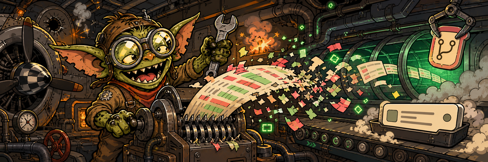

# git-gremlin



Commit, draft PR, and complete PR delivery for Claude Code and Codex.

It recognizes commit or PR intent, drafts the boring text from the current git state, stages
dirty changes when an actual commit needs them, and publishes local branches as draft PRs
after the PR confirmation gate. When `linear-devotee:plan` chains to `commit` and `pr` after a
verified implementation, that chain is the approval and the draft PR opens without asking.
An explicit PR-completion request or an authorized `linear-devotee:deliver` handoff continues
through native review, scoped corrections, local verification, review comments, CI, and a
protected merge. It reuses the PR on resume and reports completion only after GitHub confirms
the actual merge. Code review belongs to the runtime's native reviewer. When a source spec or issue Acceptance is available, PR
preparation invokes Acid Prophet to check local changes and the committed PR payload
for drift. Workspace orchestration stays outside Git Gremlin.

## Skills

| Skill                                | Purpose                                                                          |
| ------------------------------------ | -------------------------------------------------------------------------------- |
| `git-gremlin:commit`                 | Commit a staged selection, or stage dirty changes when no selection exists       |
| `git-gremlin:handle-review-comments` | Push before announcing a fix; reply, then resolve every refused comment          |
| `git-gremlin:pr`                     | Draft a PR, then publish the branch and create it as a draft after approval      |
| `git-gremlin:finish-pr`              | Review, repair, verify, and merge an existing PR under scoped delivery authority |

`handle-review-comments` is an ambient discipline, not a triage workflow. It never decides
whether feedback is valid, and it orders no `git commit` or `git push` of its own. It adds
two laws to whatever workflow the acting agent already has. A reply announcing a fix must
not precede the push of that fix: until the code is on the remote, the thread would be
claiming a correction no later agent and no human reader can see. And every comment the
agent excludes, judges invalid, rules out of scope, or otherwise refuses to act on receives
an explanatory reply and is then resolved, as part of completing the task.

## Agents

None. Commit and PR drafting run directly in their skills so the approval context and Git
permissions stay in one place.

`finish-pr` uses native `codex review --base` or Claude Code's local `/code-review`, reads their
findings, and checks GitHub directly through `gh`. A successful reviewer command is not a clean
review. CI, outstanding change requests, unresolved threads, and branch protections retain
their own gates. A queued PR returns `waiting`; an unavailable reviewer or unresolved product
decision returns a specific blocker. Standalone commit, PR drafting, and review-only requests
keep their original scope.

For an automatic delivery caller, `scripts/wait-pr.mjs` observes one exact PR at a bounded
interval, then reports a relevant change, expiration, or unavailable evidence. The worker owns
its background completion and resumes `finish-pr`; unchanged API samples spend no model turns.
The observer never merges or interprets repository policy. Standalone callers receive an
explicit resume action without requiring a notification plugin.

Behavioral evaluation scenarios are in [evals/finish-pr.md](evals/finish-pr.md).

## Install

Claude Code:

```text
/plugin marketplace add g-bastianelli/nuthouse
/plugin install git-gremlin@nuthouse
```

Codex CLI:

```text
codex plugin marketplace add g-bastianelli/nuthouse
```

Then open `/plugins` and install `git-gremlin`.
