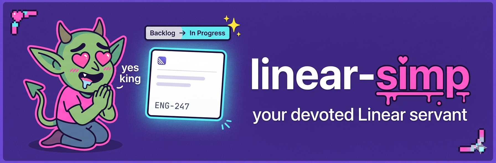

# linear-devotee



Linear workflow plugin for Claude Code and Codex.

Turn an issue or product spec into work an engineer can understand, implement, and verify.
The workflows read source decisions and relevant code, preserve exact Acceptance identities,
and review the complete proposal before handing it to implementation or writing Linear resources.

## Skills

| Skill                             | Purpose                                                                                                                                 |
| --------------------------------- | --------------------------------------------------------------------------------------------------------------------------------------- |
| `linear-devotee:greet`            | Brief a fresh issue with decision sources, resolve its spec and project plan, and prepare authorized delivery                           |
| `linear-devotee:plan`             | Revise or write an issue-scoped implementation plan, review it at the appropriate depth, and hand off validated work                    |
| `linear-devotee:deliver`          | Own one issue through implementation, native PR review, corrections, protected merge, and observed Linear completion                    |
| `linear-devotee:next-issue`       | Recommend available work from current statuses and actual blockers, identifying active work separately                                  |
| `linear-devotee:create-project`   | Draft complete issue packets and meaningful milestones, review coverage and dependencies, then create and verify the authorized cascade |
| `linear-devotee:create-milestone` | Add one delivery boundary with observable exit evidence and an optional agreed date                                                     |
| `linear-devotee:create-issue`     | Add one coherent SDD issue with exact criteria, implementation context, and verification                                                |

A partial project cascade resumes through `create-project`. Standalone additions do not replay
its unfinished mutations.

## Planning quality

The issue's active Acceptance defines its delivery scope. A project spec constrains the issue,
but criteria owned by other tickets do not become mandatory tasks in every plan. Source-backed
criteria retain exact `AC-###` ids and text; standalone criteria use `AC-L###`. A foundation issue
names the work it enables and verifies its own output. Shared criteria have explicit contribution
and integrated-verification ownership.

Discovery reads affected entry points and tests. A proposed new file is different from a missing
reference that was claimed to exist. Comments retain decision provenance, and a newer suggestion
does not silently replace approved behavior. Existing plans preserve completed work and revise
versions deliberately. Relative project-plan source paths resolve from the containing plan file.

The interview asks whatever consequential questions the work needs. It reuses provided answers
and delegates ordinary reversible implementation choices within the user's authority. Reviews
challenge behavior and observable verification: an AC label or a passing helper test does not
prove the requested integration works. Review loops stop on a specific unresolved decision.

Once a requested implementation is complete and verified, the plan hands it to
`git-gremlin:commit` and `git-gremlin:pr`. Scoped simplification runs first, with verification and
a commit for any cleanup. Native code review then runs before publication, supported
defects are corrected within scope, and the verified committed repairs are reviewed again.
The draft PR opens without another approval once that review clears. An unavailable reviewer
or unresolved finding blocks publication with a concrete next action. This also applies to
ordinary implementation that stops at the draft PR.

## Full issue delivery

Ask `linear-devotee:deliver <issue-id>` to deliver through merge, or let an authorized Monkey
Maestro worker call it in the issue's Superset workspace. This supplies one scoped authority
for implementation, commits, PR publication, review corrections and replies, protected merge,
and the issue's started/completed transitions. Briefs, plans, and draft-only requests keep
their own scope. The startup hooks yield to an explicit delivery owner.

`deliver` reads context directly, reuses the reviewed plan and existing PR, and delegates the
GitHub lifecycle to `git-gremlin:finish-pr`. Code review uses the active Codex or Claude native
command. The issue owner may use bounded specialists with distinct file ownership and reviews
integration after meaningful changes. Missing tools, product decisions, persistent failures,
and external waits produce an actionable `blocked` or `waiting` result for the coordinator.

Recovery reads current Linear, Git, and GitHub state in the existing workspace. A merge queue
or quiet terminal is not completion. Only an observed merged PR and the actual team's completed
Linear state produce `done`. If merge succeeded but the Linear update failed, recovery performs
only the missing status reconciliation. It never starts another PR or reopens a terminal issue.

## Delegation

| Agent                  | Responsibility                                                                             |
| ---------------------- | ------------------------------------------------------------------------------------------ |
| `issue-context`        | Bounded read of the issue, decision-bearing comments, status, blockers, and relevant code  |
| `plan-auditor`         | Independent review of issue scope, integration, source consistency, and verification       |
| `project-drafter`      | Complete deliverables and dependency reasoning; independent proposal review when requested |
| `milestone-drafter`    | Delivery boundary, exit evidence, and existing/new issue scope                             |
| `issue-drafter`        | Complete SDD description and consequential questions for one issue                         |
| `project-graph-loader` | Fresh authoritative reload of marked entities and blocking relations                       |

Agents remain read-only. Small conventional issue plans receive a local walkthrough; new
boundaries, interacting tasks, consequential risks, and explicitly requested independent reviews
use the plan auditor. Reuse applicable findings and check changed relationships instead of
repeating the entire review at every handoff. Issue count does not dictate phases.

## Creation and recovery

Creation skills show complete content and apply existing explicit authorization; otherwise they
ask for approval of the finished preview. The full project cascade has one mutation approval,
with all bodies, dates, labels, memberships, and relations resolved before writing.
Detailed source/code discovery belongs to the drafter; the caller checks source authority and
Acceptance without repeating that discovery. Reviews return findings instead of repeating the
proposal. Revisions replace affected sections while preserving the complete draft for approval.

The existing graph helper checks structure and exact mutation-envelope consistency. The agent
reviews source coverage and deliverability. Stable markers identify potentially successful writes
after timeouts; a readable ledger records confirmed progress. Recovery reads the same approved
envelope, reloads Linear, and resumes confirmed missing work without recreating known resources.

One authoritative reload supplies the graph and written fields for verification. Written
bodies and other fields must match the preview before execution is ready. A discrepancy,
including changed Acceptance wording under an unchanged id, blocks that handoff. Source linkage
preserves spec ratification and review metadata.

Greet and full delivery share the same verified started transition. Delivery also reconciles
completion after merge, including an automatic Linear transition that already occurred. A
read-only brief does not change lifecycle state; ambiguous team statuses need a real decision.

## Verification

Behavioral fixtures and bounded observations are described in [evals](evals/README.md).
Runtime checks cover the existing hook lifecycle, mutation envelope, and graph recovery logic:

```sh
bun test linear-devotee/
bun run test:meta
bun run check:codex-agents
bun run check:skills
```

## Install

Claude Code:

```text
/plugin marketplace add g-bastianelli/nuthouse
/plugin install linear-devotee@nuthouse
```

Codex CLI:

```text
codex plugin marketplace add g-bastianelli/nuthouse
```

Then open `/plugins` and install `linear-devotee`.
